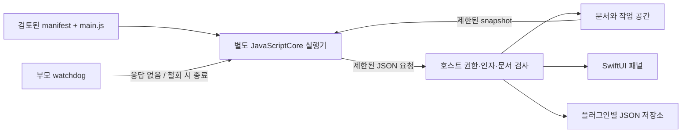

# EmberPDF 확장 플랫폼 — 2026-10-05

> 이 문서는 build 26의 당시 구현·검증을 보존합니다. 후속 schema 6 창 수명 확장과 현재 검증은 [2026-10-06 확장 기록](EXTENSIONS-2026-10-06.md)을 따릅니다.

플러그인은 미리 정한 기능 모음에 한정하지 않는다. 개발자는 JavaScript로 문서 정보를 조합하고 자신의 명령·이벤트 처리·UI를 구성한다. 문서와 파일에 영향을 주는 작업은 앱이 소유한 API를 통과한다. 기존 선언형 패키지와 새로운 실행형 패키지는 이 권한 경계를 함께 사용한다.

## 확장 방식

| 형태 | 지원 범위 |
| --- | --- |
| Schema 1 | 선택 텍스트·문서 metadata를 이용한 텍스트 표시/복사·확인 후 외부 링크 |
| Schema 2 | 공식 번역·웹 패널. 앱 번들과 정확히 일치하는 검토본만 설치 |
| Schema 3 | 호스트 주석·도구·페이지/모드 명령 |
| Schema 4 | 커뮤니티가 호출할 수 있는 색상·Markdown 노트·페이지 이미지·관련 문서·커서 번역 패널 |
| Schema 5 | `main.js`와 코드 SHA-256, 명시적 script capability를 가진 별도 JavaScript 실행기 |

Schema 4 패널은 API 사용 사례다. Schema 5는 새로운 기능을 만드는 계산·이벤트·UI 틀이며, 기존 패널 다섯 가지 중 하나만 고르게 하는 방식이 아니다. 임의 HTML·CSS·DOM 또는 앱 내부 Swift 객체를 확장 API로 공개하지는 않는다.

## 개발자에게 제공하는 계약

- `ember.call(method, params)`는 비동기 JSON host API다. 문서 metadata·선택/현재 페이지 텍스트·열린 문서 목록/검색·탐색·노트·표시 설정을 명시된 권한 범위에서 다룬다.
- `ember.ui.render(view)`는 호스트가 그릴 제목·텍스트·목록·입력란·버튼을 전달한다. 받은 텍스트를 HTML이나 명령으로 실행하지 않는다.
- `ember.commands.register({ id, title, run })`으로 플러그인 명령을 추가한다. 명령 callback은 실행기에 남고, 호스트는 ID와 표시 이름만 받는다.
- `ember.on(name, callback)`으로 load, 페이지·선택 변화, 사용자 입력과 버튼 이벤트를 처리한다. 반환된 함수를 호출하면 listener를 제거한다.
- 플러그인별 JSON 저장소는 명시적 저장 권한이 필요하며 64 KiB로 제한한다. 패키지 업데이트/재시작에서는 유지하고 제거 시 삭제한다. 비밀 키 저장소가 아니다.

Obsidian의 명령 추가와 `onload` 방식은 개발자 진입점을 이해하는 데 참고했고, 이벤트·타이머·child component를 unload 때 정리하는 공식 권고는 실행 수명을 정하는 기준으로 삼았다. EmberPDF의 종료 경계는 호스트가 통제하며 callback의 협조를 기다리지 않는다. [Obsidian 시작 가이드](https://docs.obsidian.md/Plugins/Getting%20started/Build%20a%20plugin), [수명 관리 가이드](https://docs.obsidian.md/plugins/guides/lifecycle-management).

## 권한과 실행 수명

Manifest에 권한을 적었다고 승인되는 것은 아니다. 호스트 저장소에는 사용자가 검토한 manifest digest와 실제 승인·철회를 별도로 기록한다. 업데이트를 검토하면 새 권한을 승인할 수 있지만 기존에 철회한 권한은 유지한다. 패키지를 디스크에서 바꿔도 승인은 따라가지 않는다. 권한이 필요 없는 단순 표시 action도 검토된 digest여야 실행한다.

최초 승인 기록 이전은 과거 버전에서 지원했던 schema 1–3 설치본만 대상으로 한다. 새로운 schema 4·5 패키지는 설치 폴더에 존재하거나 자체 설치 기록과 해시가 맞아도 사용자가 검토하기 전에는 실행하지 않는다.

사용자는 개별 권한을 철회하거나 안전 모드로 전체 플러그인을 중지할 수 있다. 실행 중인 명령은 최초 실행뿐 아니라 외부 확인창을 닫은 뒤와 실제 host 작업 직전에 다시 검사한다. PDF 복사·주석 권한은 플러그인 승인과 별개이며, 허용되지 않은 PDF 내용은 추출하지 않는다.

실행기는 해당 패널/문서에 종속된다. 닫기·탭 변경·문서 변경·권한 철회·플러그인 변경으로 실행 수명이 끝나면 process와 대기 요청을 정리한다. `unload`가 반드시 실행된다는 계약은 없다. 미저장 Markdown 노트는 앱의 작업 공간에 보존하고 사용자의 저장/닫기 흐름으로 처리한다.

## 프로세스 및 메시지 경계

1. 코드 SHA-256을 manifest에 포함하고, 설치·로드·실행 시작 때 코드를 재검사한다. 실행에는 캡처한 bytes만 사용한다.
2. Worker에는 PDFKit·AppKit·Foundation·Objective-C 객체나 파일/네트워크 API를 제공하지 않는다. 코드 안에 Node 패키지를 import하거나 shell을 실행하는 기능은 없다.
3. 입출력 256 KiB, JSON 깊이와 배열·객체 수, callback·명령·진행 중 요청 수를 제한한다. Host UI 모델과 저장소에는 더 작은 상한을 둔다.
4. 호스트는 dispatch별 3초 watchdog으로 무한루프 실행기를 종료한다. JavaScript가 native `idle` 신호를 만들어 deadline을 해제할 수 없도록 bridge를 숨기고 native 출력 타입도 제한한다.
5. Helper는 앱의 sandbox를 상속한다. 상속된 OS 권한과 script에 공개한 API는 별개다. 엄격한 JSC heap hard limit 또는 JSC/OS 취약점 부재를 보장하지 않는다.

WKWebView도 별도 프로세스를 사용하지만 `stopLoading`은 코드 강제 종료와 다르다. 실행 시간 상한을 부모가 통제하기 위해 종료 가능한 helper 프로세스를 선택했다. 원격 웹 패널은 기존 WebKit 경로에 남으며 커뮤니티 코드의 실행기로 사용하지 않는다. [WebKit 다중 프로세스 구조](https://docs.webkit.org/Deep%20Dive/Architecture/WebKit2.html), [Apple helper 도구 문서](https://developer.apple.com/documentation/xcode/embedding-a-helper-tool-in-a-sandboxed-app).

## 검증 범위

현재 소스와 로컬 패키지 후보는 **0.9.0 build 26**이다. 아래 기록의 기준일은 2026-10-06이며, 이전 빌드의 검사 수나 ZIP checksum을 재사용하지 않는다.

| 검증 항목 | 상태 |
| --- | --- |
| 실제 helper 프로토콜 smoke | 최종 worker 소스로 빌드된 실행 파일에서 7개 모두 재통과 |
| 통합 XCTest | 네 실행에서 중복을 제외한 139개 통과, 실패 0. 전체 저장소 테스트 일괄 실행 결과는 아님 |
| 프로젝트 정적 검사 | build 26 버전·리소스·10개 언어·SwiftPM 앱/helper 구성 검사 통과 |
| Release 앱·ZIP·helper 서명·리소스 | 최종 문서를 포함한 build 26 재패키징·서명·리소스 검사 통과. 설치된 앱과 helper의 실행 파일이 최종 패키지와 일치 |
| build 26 ZIP SHA-256 | `18c53bc376f6806949a7de91107b6b9f4c2c699987680ef5d5313c44ac86701a` |
| 실제 앱 UI | 설치된 build 26에서 SDK·페이지 이벤트·노트 전달·권한 철회·페이지 PNG 저장 확인. 후속 빌드에서 Return 명령 실행과 Markdown 신규/기존 저장·다시 열기까지 재확인 |
| 장시간 사용 | 이번 검증에서 새로 실행하지 않음 |

최종 패키지 로그는 `work/ember-plugin-foundation-20261005/package-final.log`, UI 확인과 산출물 해시는 같은 폴더의 `gui-verification.json`에 기록했다. 테스트 탭을 닫고 기존 12개 문서 및 사용하던 페이지로 복귀했다.

자동 검사의 구성은 기반·플러그인 검사 101개, 노트·저장/주석 회귀 53개(앞선 실행과 22개 중복), 최종 SDK 검사 24개(새 회귀 3개, 재확인 21개)다. 최종 24개에는 권한 검사 11개, 실제 helper/호스트 결합 검사 6개, 패키지 제작 검사 3개, 플랫폼 검사 4개가 포함된다. SDK의 새 회귀는 schema 4·5 최초 자동승인 거부, 비동기 callback 오류 중지, 명령 24개 등록 시 합쳐진 게시와 중지 시 명령 제거를 확인한다. 이후 노트 저장·script 노트 API 검사 22개가 모두 통과했다(노트 16개·host API 6개, 앞선 검사와 18개 중복). 새 파일의 staging 중 생성 충돌, 기존 파일의 외부 교체, leaf symlink 교체, 부모 디렉터리 교체를 검사하는 4개를 합쳐 고유 139개다.

개발용 실행 로그는 `work/ember-plugin-foundation-20261005/foundation-tests-final.log`, `notes-integration-tests.log`, `sdk-final-tests.log`, `notes-sandbox-save-tests.log`이며 helper 독립 검사 기록은 `work/plugin-worker-smoke.json`이다. 마지막 smoke는 worker 소스 수정 시각보다 늦게 생성된 실행 파일을 사용했으며 추가 빌드 없이 실행했다.

정적 검사는 `work/ember-plugin-foundation-20261005/validation-final.log`에 기록했다. 제한된 개발 환경의 SwiftPM 사용자 캐시 쓰기 경고가 있었지만 검사 자체는 종료 코드 0으로 통과했다. 후속 수정까지 포함한 Release 생성·ZIP 재개방 검사는 `release-final-build.log`를 따른다. `/Applications`에 설치한 최종 앱은 deep/strict 코드 서명 검사와 앱/helper bytes 일치 확인을 통과했으며, 실제 기능 UI 검사는 아래에 기록한다.

### 설치된 앱에서의 기능 확인

2026-10-06에 `/Applications/EmberPDF.app`의 build 26을 실행했다. 기존 작업 공간의 12개 탭이 복원되는 것을 확인한 뒤, 새 기능의 내용 읽기·페이지 전환·노트 전달은 직접 만든 2페이지 PDF fixture로 검사했다. 사용자 원본 PDF를 수정하거나 저장하지 않았다.

| 시나리오 | 관찰 결과 |
| --- | --- |
| Reading Lab 설치·시작 | 설치 검토 후 별도 worker가 실행되고 호스트가 그린 분석 UI가 표시됨 |
| 현재 페이지 이벤트 | fixture의 1페이지와 2페이지를 오가면 단어 수가 2와 0으로 갱신됨 |
| 실행형 명령 팔레트 | 등록된 명령이 팔레트에 표시되며 마우스로 선택하면 실행됨 |
| 입력에서 노트로 전달 | 입력 문장을 `notes.append`로 추가하고 Markdown Notebook 패널로 전환한 뒤 같은 내용이 보존됨 |
| 읽기 권한 철회 | `currentPageText`를 철회하자 실행 패널이 즉시 닫히고 관련 명령이 비활성화됨. 확인 후 권한을 복원함 |
| 페이지 이미지 저장 | Page Clipper 검토본 설치 후 합성 PDF의 현재 페이지를 macOS 저장 패널로 PNG 저장함. 앱의 성공 표시와 실제 1,224×1,584 PNG 파일을 확인함 |
| 종료 시 미저장 노트 보호 | QA에서 만든 미저장 노트가 있으면 종료 확인이 나타나고, 취소하면 앱과 노트가 유지됨. QA 노트만 버리기를 선택한 뒤 정상 종료됨 |
| 팔레트의 Return/Enter 실행 | 기존 설치 action만 찾던 경로를 수정한 뒤 재확인함. Reading Lab 실행 중 `⇧⌘P`에서 Analyze를 검색하고 Return을 누르면 팔레트가 닫히고 분석 패널이 정상 실행됨 |
| Markdown 신규 저장 | 최초 검사에서 발생한 `EPERM`을 선택 파일 권한·시스템 replacement 디렉터리 경로로 수정함. 후속 설치 앱에서 SDK가 만든 초안을 macOS 저장 패널로 새 `.md`에 저장했고, 오류 없이 저장 버튼이 비활성화됨 |
| Markdown 수정 저장·다시 열기 | TextEditor에서 내용을 바꾼 뒤 기존 파일에 저장 성공. 실제 102바이트 파일과 내용 일치를 확인하고 macOS 열기 패널로 같은 파일을 다시 열었을 때 수정 내용이 표시됨 |

페이지 클립 산출물은 `work/ember-plugin-foundation-20261005/ember-plugin-gui-clip.png`, Markdown 저장·재개방 산출물은 `work/ember-plugin-foundation-20261005/ember-sdk-gui-note.md`다. 클립보드 복사와 외부 앱으로 드래그는 이번 UI 검사에서 직접 확인하지 않았다. 발견했던 Return 실행과 Markdown 저장 오류는 후속 수정·관련 회귀 검사·설치 앱 재확인을 마쳤다. 앞의 XCTest 139개에는 후속 노트 저장 수정 검사가 포함되며 helper smoke 7개는 현재 worker에 대한 결과다.

노트 파일 저장의 후속 설계는 선택 파일의 sandbox 권한과 시스템 replacement 디렉터리를 사용한다. 모든 경로의 symlink를 거부하는 open, 일반 파일·크기·버전/digest 확인, hardlink 덮어쓰기 거부와 신규 파일의 exclusive commit을 유지한다. 다만 pathname 기반 최종 교체는 검사 이후 비협력 로컬 프로세스의 부모/대상 경로 교체까지 원자적으로 배제하지 않으므로, 이전 부모 descriptor 고정과 동등한 경합 방어라고 주장하지 않는다. 세부 경계는 [보안 가이드](PLUGIN-SECURITY.md)를 따른다.

권한 회귀 검사는 독립 권한 철회·재시작·업데이트·손상된 승인 기록·디스크 교체·안전 모드·외부 확인 중 철회·제거 후 데이터 삭제를 다룬다. 패키지 파일 검사는 디렉터리 교체, symlink/FIFO/디렉터리 거부, 크기/경로 제한, manifest와 설치 기록 snapshot을 확인한다.

실제 별도 helper로 실행한 프로토콜 smoke 7개는 모두 통과했다: 숨겨진 bridge와 부재한 ambient API, async/await 응답 처리, 등록 명령 dispatch, 무한루프의 idle 위조 방지와 강제 종료, 과도한 입력 거부, JavaScript 오류 전달, 비동기 callback 오류 보고. 이는 앱 UI 전체의 실기기 검증이나 엄격한 메모리 사용 상한을 대신하지 않는다. 통합 회귀 결과와 배포 검증은 품질 보고서에서 관리한다.

코드 검증과 publisher 검증은 구분한다. 일반 커뮤니티 ID의 세계적 소유권, 게시자 서명, 온라인 보안 심사, 자동 업데이트 카탈로그, 임의 npm 모듈/네트워크/DOM 확장은 현재 제공하지 않는다. 새로운 API는 capability·인자/결과 상한·취소·철회·테스트를 함께 추가해야 한다. 자세한 위협 경계는 [플러그인 보안 가이드](PLUGIN-SECURITY.md)를 참고한다.
