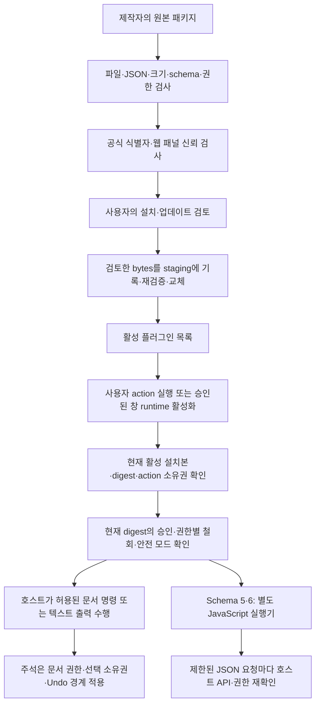

# 플러그인 제작자와 검토자를 위한 보안 가이드

2026-10-06, build 27 확장 플랫폼 구현 기준. 제작자는 패키지가 읽고 바꾸고 전달하는 데이터를 설명하고, 호스트는 선언한 권한과 사용자가 승인한 권한을 별도로 검사한다. Schema 1–4는 호스트 기능을 호출하는 선언형 패키지이고, schema 5·6은 별도 실행기에서 JavaScript를 실행한다. “플러그인 검증 통과”는 제작자 신원 인증이나 무해성 보증이 아니다.

[제작 가이드](PLUGIN-DEVELOPMENT.md) · [호환성/향후 SDK](PLUGIN-COMPATIBILITY.md) · [취약점 비공개 제보](../SECURITY.md)

## 1. 패키지가 실행되는 경로

실행 시 digest 확인은 **현재 메모리 registry와 메뉴가 캡처한 설치본**을 비교하는 것이다. 매 명령마다 디스크의 모든 파일을 새로 해시하는 것은 아니다. 설치본의 manifest 변조는 설치·로드·새로 고침 경로에서 검사한다. Script 패널이나 창 runtime을 시작할 때는 설치 패키지를 다시 검사하고, `main.js`의 SHA-256이 검토된 manifest의 `scriptSHA256` 또는 `runtime.sha256`과 일치하는지 확인한 뒤 캡처한 코드만 실행기로 전달한다. 설치 검토와 최종 교체 사이에는 검토 당시 읽은 제한된 bytes를 사용한다.

패키지 디렉터리는 열린 descriptor로 고정한다. 각 payload는 `openat`의 `O_NOFOLLOW`·`O_NONBLOCK`과 `fstat`으로 실제 열린 일반 파일인지 확인하고, 크기 상한과 읽기 전후 inode·size·mtime·ctime을 검사한다. 검사와 읽기 사이에 파일이 링크나 FIFO로 바뀌는 경우를 거부한다. Manifest와 설치 기록도 같은 디렉터리 snapshot에서 읽는다. 이는 악의적인 로컬 프로세스 전체를 인증하거나 네트워크 파일시스템의 모든 지연을 제거하는 보장은 아니다.

## 2. 현재 막는 것과 그 한계

| 경계 | 현재 구현 | 한계/제작자의 책임 |
| --- | --- | --- |
| 실행 파일/숨겨진 코드 | 허용 파일명 6개, 일반 파일만 허용. `main.js`는 schema 5·6과 코드 digest가 있어야 허용. 하위 디렉터리·심볼릭 링크·추가 파일 거부 | 앱/PDFKit/JavaScriptCore/OS 자체의 모든 취약점을 없애는 보장은 아님 |
| 모호한 manifest | BOM·중복 JSON 키·알 수 없는 키/enum·잘못된 타입/범위 거부 | JSON 문법 검사만으로 호스트 규칙을 대신하지 않음 |
| 과도한 입력/결과 | 패키지·manifest·action·출력·URL 크기 상한 | PDF 자체가 복잡하면 렌더링 비용이 발생. 대용량 실기기 테스트 필요 |
| 권한 확대 | 선언된 권한과 실제 승인 기록 분리, action의 최소 권한 검증, 권한별 철회·긴급 전체 중지 | 새 기능을 추가할 때 host API에서도 권한을 검사해야 함 |
| 공식 플러그인 사칭 | 공식 예약 ID와 패널은 앱 번들의 identifier+manifest digest 일치 요구 | 일반 제작자 ID는 전 세계 소유권을 인증하지 않음 |
| 설치본 변경 | manifest digest·설치 기록·디렉터리 식별자 검사, 실패 시 로드 제외 | 설치 기록과 payload를 모두 바꿀 수 있는 로컬 공격자를 인증으로 막는 장치가 아님 |
| 오래된 실행 요청 | 활성 상태·현재 digest·action 소유권·승인 재확인, 모달 이후 다시 검사 | 이미 만든 주석·메모·사용자가 저장한 파일은 철회로 자동 롤백하지 않음 |
| PDF 주석 변경 | 현재 문서/선택 객체·모드/문서 권한 확인, 기존 Undo/Redo 사용 | 원본 콘텐츠 스트림 편집·보안 삭제·인증서 디지털 서명 API는 없음 |

`icon.png`는 현재 PNG signature만 검사하며 UI 아이콘으로 사용하지 않는다. README·라이선스·icon을 포함한 모든 보조 파일의 진위가 manifest SHA-256으로 인증되는 것은 아니다. 저작권과 출처는 별도로 확인한다.

### 승인과 철회

- 첫 설치는 검토된 manifest의 권한을 승인한다. 업데이트도 사용자가 검토하여 설치한 경우에만 새 권한을 승인하며, 이전에 철회한 권한은 계속 철회된 상태로 남는다.
- 승인은 manifest digest에 묶인다. 디스크에서 패키지와 설치 기록을 함께 바꿔도 새 digest는 자동으로 승인되지 않는다. 권한이 없는 단순 표시 작업도 미검토 manifest에서는 실행하지 않는다.
- 이전 버전에서 지원한 schema 1–3의 검증된 설치본만 처음 실행할 때 한 번 기존 승인을 이전한다. 새 schema 4·5는 디스크에 미리 존재해도 명시적인 설치 검토 전에는 승인하지 않는다. 승인 저장소가 손상된 경우에는 자동 이전으로 권한을 되살리지 않는다.
- 안전 모드는 설치 파일이나 개별 권한 선택을 지우지 않고 모든 플러그인 실행을 중지한다. 권한 철회·비활성화·업데이트·제거는 관련 실행기·패널·진행 중 요청을 회수한다. schema 6은 문서·워크스페이스 변경에서 실행기를 유지하되 이전 문서에 속한 요청을 취소하고 새 문맥 이벤트를 보낸다.
- 외부 서비스 전송이나 외부 링크 열기는 기존 실행별 확인 절차를 계속 사용한다. 설치 승인만으로 자동 전송을 승인하지 않는다.

## 3. 읽기·수정·외부 전송을 구분하기

### 로컬 문서 명령

`annotationWrite`는 현재 선택에 주석을 추가하는 호스트 명령이다. 텍스트 추출 권한인 `selectedText`와 분리되어 있다. `toolControl`은 펜·지우개·선택 도구를 설정하고, `workspaceNavigation`은 모드/페이지를 바꾼다. 이 권한들이 임의 파일 쓰기, 앱 설정 전체 변경, 장치 접근, 네트워크 권한을 뜻하지 않는다.

주석을 만들면 문서는 미저장 상태가 되고 사용자 저장 흐름을 따른다. 호스트의 자동 복구 설정이 켜져 있으면 로컬 복구 사본이 생길 수 있다. “파일을 자동으로 덮어쓰지 않음”을 “어떤 로컬 데이터도 남지 않음”으로 설명하지 않는다. 암호화 문서는 기존 문서 권한과 보호된 저장 정책을 따른다.

외부 PDF가 `HwattakPDF`와 같은 Stamp 이름을 붙여도 학습 모드에서 신뢰된 주석이 되지는 않는다. 해당 세션에서 확인한 객체 신뢰와 에디팅 모드의 명시적 편집 경계를 유지한다.

### 텍스트·클립보드

선택 텍스트·문서 이름에는 개인정보가 있을 수 있다. 필요한 권한만 선언하고 전체 디스크를 읽는 기능인 것처럼 설명하지 않는다. 선언형 현재 페이지 텍스트 토큰은 번역 패널 전용이다. Schema 4의 관련 문서 검색과 schema 5·6의 승인된 host API는 별도 권한을 통해 제한된 페이지 텍스트나 열린 문서의 검색 결과를 읽을 수 있다. 모든 텍스트 추출은 PDF 복사 권한을 다시 확인한다. 선택은 제한된 길이로 캡처되며 결과가 상한을 넘으면 실패하거나 `truncated` 결과가 된다.

`copyText`는 시스템의 일반 클립보드에 쓴다. 다른 앱이나 시스템의 클립보드 기능이 해당 내용을 취급할 수 있다. 클립보드 권한을 네트워크가 없는 비밀 저장소라고 설명하지 않는다. manifest와 README에 비밀번호·API 키·토큰·실제 계약서 내용을 넣지 않는다. 패키지 전용 Keychain/비밀 저장 API는 없다.

### 공개 HTTPS 링크

`openURL`은 대상과 문서 metadata/선택 텍스트 포함 여부를 확인한 뒤 외부 브라우저를 연다. 취소는 정상 종료다. 제작자는 README에 서비스 이름·도메인·전달되는 데이터를 밝힌다.

URL의 `.urlEncoded`는 문자 구분 문제를 막는 인코딩이다. 익명화가 아니며 서버·브라우저 기록 등에 질의가 남을 수 있다. HTTPS는 대상의 선의나 개인정보 보존 정책을 인증하지 않는다. 비밀 키를 query에 넣거나, 설치 검토 문구를 속여 사용자 확인을 유도하지 않는다. `http:`, `file:`, `javascript:`, `obsidian:` 및 내부 주소를 허용하려고 검증기를 우회하지 않는다.

### 호스트가 소유한 웹 패널

일반 커뮤니티 패키지는 자체 HTML·원격 웹뷰 패널을 넣을 수 없다. 허용된 공식 패널은 원격 웹사이트를 WebKit으로 열 수 있으며 원격 페이지의 JavaScript는 실행될 수 있다. 패키지 코드 실행과 원격 사이트 동작을 구분한다.

여기서 제한하는 것은 **임의 HTML/DOM을 가진 웹 패널**이다. Schema 5·6 커뮤니티 코드는 별도 JavaScriptCore 실행기에서 계산하고, 제한된 JSON UI 모델을 반환한다. 앱이 제목·텍스트·목록·입력란·버튼을 SwiftUI로 그리므로 script가 PDF 뷰, 웹뷰, 앱 전체 DOM을 얻지 않는다.

현재 패널은 비영구 데이터 저장소와 이동/입출력 제한, 문서·탭·플러그인 수명에 연결된 폐기를 사용한다. 완전한 네트워크 방화벽, 추적 방지, 서버 측 삭제를 보장하지 않는다. 번역 서비스별 실제 전송 흐름은 [기존 패널 가이드](PLUGINS.md)에 있다. YouTube 검토용 소스를 공식 번들에 넣는 것은 별도의 배포 검토가 필요한 변경이다.

### 네이티브 작업 패널

색상 조절, 노트, 페이지 클립, 관련 문서 검색, 커서 번역은 커뮤니티 패키지에도 공개한 호스트 기능이다. 각 기능은 다음 경계를 유지한다.

| 기능 | 데이터와 작업의 경계 |
| --- | --- |
| 읽기 색상 | 승인된 앱·종이 표시 설정만 변경. PDF 원본은 재작성하지 않음 |
| Markdown | 사용자가 선택한 UTF-8 `.md`/`.markdown` 일반 파일만 열기·저장, 1 MiB 상한, 외부 변경 충돌 검사. 미리보기의 HTML·링크·이미지는 자동 실행·요청하지 않음 |
| 페이지 이미지 | 복사 가능한 PDF의 현재 페이지를 제한된 래스터로 캡처. 최대 6백만 픽셀·한 변 4,096px·PNG 24 MiB. 복사·저장·드래그 직전에 문서 revision과 권한 재확인 |
| 관련 문서 | 이미 열린 PDF만 로컬 검색. 선언형 관련 패널은 일부 페이지의 키워드 연관성을 사용하며, 최근 문서 전체·임의 폴더를 자동 수집하지 않음 |
| 커서 번역 | 켜진 패널의 현재 PDF 창에서 잠시 멈춘 커서 아래 단어만 읽음. 전역 입력 감시 없음. macOS 15 이상 기기 내 번역 사용, 언어팩 다운로드는 OS가 안내할 수 있음 |

패널을 닫거나 권한을 철회해도 작성 중인 노트는 해당 PDF 작업 공간의 메모리에 보존된다. 탭·문서·앱을 닫을 때 기존 미저장 노트 확인 흐름을 사용한다. 권한 철회는 사용자의 작업을 삭제하라는 요청이 아니다. Script의 플러그인 전용 JSON 저장소는 별도이며, 명시적으로 플러그인을 제거하면 삭제한다.

Markdown 저장은 선택한 파일에 대한 sandbox 권한을 사용한다. 읽기와 staging 파일 생성에는 모든 경로 구성 요소의 symlink를 거부하는 `O_NOFOLLOW_ANY`를 사용하고, 부모 식별자·파일 버전·digest를 쓰기 직전에 다시 확인한다. 시스템 replacement 디렉터리에서 완성한 파일을 신규 대상에는 `RENAME_EXCL`로, 기존 대상에는 coordinated replacement로 넘기며 원본을 먼저 잘라 쓰는 fallback은 없다. 다만 **최종 검사와 pathname 기반 교체 사이의 간격까지 하나의 원자적 비교/교체로 묶지는 않는다.** 파일 조정에 협력하지 않는 로컬 프로세스가 그 순간 부모 경로나 대상을 바꾸는 경합을 완전히 막거나 사후 검사만으로 이미 이루어진 교체를 되돌린다고 보장하지 않는다. 이 한계는 JavaScript에 파일 경로·직접 파일 API를 공개한다는 뜻은 아니다.

## 4. 제작·배포 검토

| 시점 | 확인할 내용 |
| --- | --- |
| 설계 | 필요한 최소 권한, 사용자 실행/취소, 원본 보존, Undo, 데이터 수명 |
| 구현 | 지원 필드만 사용, 공개된 코드와 패키지 일치, 비밀/실제 PDF 제외 |
| 검증 | 앱의 native 검사기, 권한 거부·잘못된 문서·업데이트·취소 사례 |
| 배포 | 실제 제작자·소스·라이선스·지원 환경·데이터 흐름·보안 연락 방법 공개 |
| 업데이트 | 새 권한과 전송 대상, 변경 이유, 호환성/되돌리기 안내 |
| 사고 대응 | 문제가 있는 릴리스 안내, 수정 배포, 필요 시 비활성화 권고와 비공개 취약점 신고 |

현재 온라인 카탈로그·자동 악성 패키지 검사·게시자 서명·자동 취약 버전 차단은 구현되지 않았다. 파일 checksum과 manifest digest를 제공할 수 있지만 이것을 “공식 보안 인증”이라고 부르지 않는다. 앱의 검사 성공 문구만으로 안전한 출처라고 단정하지 않는다.

## 5. Schema 5·6 실행형 SDK의 경계

EmberPDF는 확장 코드를 별도 프로세스로 분리하고 승인된 API마다 접근 권한을 확인한다. schema 6의 `backgroundExecution`은 앱 창이 열린 동안의 실행을 명시적으로 승인하는 권한이다. 패널 표시 여부에 기대어 실행 허용을 판단하지 않는다. 실행기는 창·플러그인별로 분리되며 앱 전체 8개 상한을 적용한다.

`EmberPluginWorker`는 별도 프로세스의 JavaScriptCore이며, 유일한 연결은 제한된 JSON 메시지다. PDFKit/AppKit 객체·전체 파일 경로·security bookmark·Keychain·Foundation/Objective-C 객체는 script로 보내지 않는다. `require`, `fetch`, XHR, Node `process`, 타이머, 임의 파일 API는 제공하지 않는다. 현재/명시한 페이지 읽기·노트 작성·문서 명령·탐색·색상 변경·저장은 명시된 host API와 capability 검사를 거친다.

입출력 메시지는 256 KiB, 입력 JSON 깊이는 24단계로 제한한다. Worker는 이벤트 listener 32개·명령 24개·미완료 요청 32개와 dispatch별 전송 상한을 둔다. 부모 호스트도 큐·동시 요청·실행 빈도를 제한하며, 한 dispatch가 3초 안에 돌아오지 않으면 실행기를 종료한다. `idle`은 JavaScript가 실제 반환한 후 native 코드만 출력한다. Script는 숨겨진 native post나 dispatch 함수를 얻거나 `idle`을 위조하여 watchdog을 해제할 수 없다.

중지는 부모가 process를 종료하고 대기 중 API를 취소하는 방식이다. `ember.dispose` callback은 최선 노력이며 강제 종료에서 성공을 보장하지 않는다. 저장할 변경은 명시적인 API로 전달해야 한다. 이벤트 callback·Promise·함수 안에만 남은 JS 메모리는 재시작 때 사라진다.

이 helper는 Apple 권고에 따라 `app-sandbox`와 `inherit` 두 entitlement로 서명한다. 이는 부모 앱의 **정적 sandbox 권한을 상속**한다는 뜻이며 OS 수준의 별도 네트워크 차단을 뜻하지 않는다. JSC에 네트워크·파일 함수를 제공하지 않는 API 경계와 구분한다. [Apple의 helper 도구 가이드](https://developer.apple.com/documentation/xcode/embedding-a-helper-tool-in-a-sandboxed-app), [sandbox 상속 설명](https://developer.apple.com/library/archive/documentation/Miscellaneous/Reference/EntitlementKeyReference/Chapters/EnablingAppSandbox.html).

JavaScriptCore의 전용 heap에 확실한 hard limit을 설정하는 공개 API를 사용하지 않으므로 엄격한 메모리 격리를 보장하지 않는다. 큰 할당은 watchdog 전에 일시적으로 시스템 메모리를 압박할 수 있고 JSC/OS의 취약점도 별도 위험이다. 제한된 메시지, 별도 프로세스, 종료 가능한 실행 시간은 이 위험을 줄이는 장치이며 완전한 무해성 증명은 아니다. 온라인 게시자 서명·자동 보안 심사·원격 배포 카탈로그도 이 구현의 범위에 없다.

## 6. 취약점 신고

공개 이슈에는 취약점 악용 절차·민감한 PDF·API 키·서명·개인 경로를 올리지 않는다. [SECURITY.md](../SECURITY.md)의 비공개 신고 절차와 실제 연락 경로를 사용한다. 버전/빌드·schema·플러그인 identifier/version/digest, 공격 전제, 비식별화된 재현 절차를 준비한다. 신고 창이 없으면 공개로 대체하지 않고 기존 정책을 따른다.
