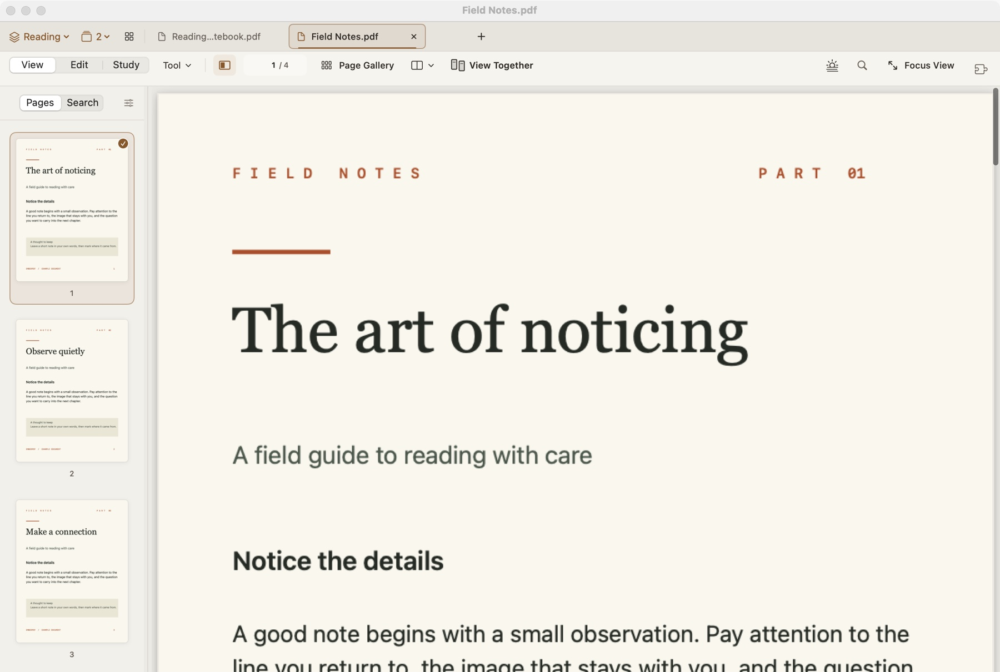

# EmberPDF

**오랫동안 든든한 PDF.**

EmberPDF는 Mac에서 여러 PDF를 나란히 읽고, 중요한 문장에 표시하고, 필요한 페이지를 한 파일로 모을 수 있는 오픈소스 앱입니다. 자료를 찾는 순간부터 읽고 정리하는 일까지 한 창에서 이어갈 수 있도록 만들었습니다.

[앱 소개와 스크린샷](https://seederpowerdrop.github.io/EmberPDF/) · [EmberPDF 1.0.0 DMG 다운로드](https://github.com/SeederPowerDrop/EmberPDF/releases/download/v1.0.0/EmberPDF-1.0.0-build91-macOS-arm64.dmg) · [개발 일지](https://seederpowerdrop.github.io/EmberPDF/journal/)

## 문서는 중심에, 파일은 Mac에

Ember는 오랫동안 은은하게 타는 잉걸불이라는 뜻입니다. 오래 곁에 두고 쓸 PDF 도구를 만들고 싶었습니다. 읽기, 검색, 주석, 기본 OCR은 계정이나 파일 업로드 없이 Mac에서 처리합니다. 편집 결과는 PDF로 저장합니다. 외부 AI 연결은 필요할 때 사용자가 설정할 수 있습니다.

- **읽기와 비교** · 탭, 문서 나란히 보기, 페이지 썸네일, 본문 검색
- **공부와 주석** · 하이라이트, 밑줄, 펜, 메모
- **편집과 정리** · 페이지 재정렬, 회전, 추출, 병합, 지원되는 PDF의 본문 수정
- **스캔 문서 OCR** · Apple Vision으로 글자를 인식해 검색 가능한 PDF 만들기
- **워크스페이스와 확장** · 주제별 작업 공간, 선택한 문장이나 페이지로 AI에 질문, 기본 및 외부 플러그인

**플러그인으로 읽는 방식을 확장하세요.** 페이지 번역, Markdown 노트, 복습 카드 등 필요한 도구를 설치하거나 직접 만들 수 있습니다. [플러그인 소개·설치·제작 안내](https://seederpowerdrop.github.io/EmberPDF/plugins/)

## Mac에 설치하기

공개 버전은 **EmberPDF 1.0.0 (build 91)**입니다. Apple Silicon Mac과 macOS 14 이상이 필요합니다. Apple 공증을 받지 않은 빌드이므로 첫 실행 시 macOS 보안 경고가 표시될 수 있습니다. 설치 절차와 SHA-256은 [릴리스 노트](https://github.com/SeederPowerDrop/EmberPDF/releases/tag/v1.0.0)에 있습니다.

## 프로젝트 자료

EmberPDF는 [HwattakPDF](https://github.com/SeederPowerDrop/HwattakPDF)에서 시작했습니다. 버전별 개발과 검수는 [개발 일지](https://seederpowerdrop.github.io/EmberPDF/journal/)와 [전체 프로젝트 기록](PROJECT-HISTORY.md)에 정리했습니다.

- [한국어 · English · Français · Русский · 中文 소개 (0.9.0 기록)](Documentation/GITHUB-OVERVIEW.md)
- [개발 문서](Documentation/README.md) · [문제 제보](https://github.com/SeederPowerDrop/EmberPDF/issues)
- [MPL-2.0 라이선스](LICENSE) · [자산 출처](ASSETS.md) · [상표 안내](TRADEMARKS.md)

현재 `main`의 앱 소스는 0.9.0 (build 90)입니다. 공개 DMG에 해당하는 소스는 [v1.0.0 태그](https://github.com/SeederPowerDrop/EmberPDF/tree/v1.0.0)에서 확인할 수 있습니다.
